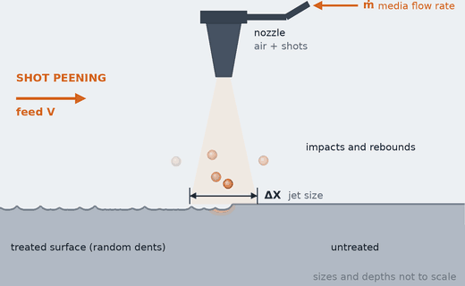

# Extended Shot Peening Coverage Simulator

**Dr Régis Kubler**, Arts et Métiers Institute of Technology
*Developed with the assistance of Claude Opus 5.5 (Anthropic), November 2026*

Interactive educational tool extending the shot peening coverage model to
**raster paths**: the nozzle sweeps the part along parallel lines, back and
forth, with a **step δ** between lines. With a jet of width ΔX, each point is
crossed by ΔX/δ lines on average, and the number of impacts can vary from
line to line in **stripes**.

**▶ Live simulator:** https://rkubler.github.io/extended-simulator/

## What the simulator shows
- Animated map of the part: raster path, jet footprint, local coverage or impacts per point
- Cross-section across the lines: coverage τ(y) and impacts per point λ(y), showing stripes
- Mean, minimum and maximum coverage in the central zone, stripe amplitude
- Coverage versus number of rasters: simulation, stripe-corrected model and average model
- One-raster coverage versus step δ
- Crossed rasters at 0° and 90°: λ(x,y) = λ₀(y) + λ₉₀(x), mean coverage 1 − mean(e^(−λ₀))·mean(e^(−λ₉₀))
- Rasters and time needed to reach 98 % coverage

An information page on the jet profile (uniform and Gaussian, equations,
overlap of neighbouring lines) opens from the ⓘ button next to the jet
profile setting: [jet_profile.html](https://rkubler.github.io/extended-simulator/jet_profile.html).

Parameters (sliders or typed values): media flow rate, density, shot size
(log-normal spread), dent radius, jet size ΔX, jet profile (uniform or
Gaussian), traverse speed V, step δ, number of rasters at 0° (horizontal lines)
and at 90° (vertical lines), order of the rasters (alternate or 0° first), half-step
offset between rasters, part length and width.

## Model
- Shots per second: Ṅ = ṁ / m̄ₚ, with m̄ₚ = ρ·π/6·E[D³]
- Area of one dent: a = π·E[r²]
- Single line (δ = ΔX): K = a·Ṅ / (V·ΔX), the original model
- Raster with step δ, average: K_δ = a·Ṅ / (V·δ) = K·ΔX/δ
- Local impacts per point: λ(y) = a·(Ṅ/V)·Σ g(y − y_j), g = jet profile across the line
- Local coverage: τ = 1 − e^(−λ); stripes always lower the mean coverage
- Uniform jet: τ = 1 − (1−f)·e^(−K·m₀·n) − f·e^(−K·(m₀+1)·n), m₀ = ⌊ΔX/δ⌋, f = ΔX/δ − m₀
- Gaussian jet (σⱼ = ΔX/4): stripe amplitude ≈ 4·e^(−2π²(σⱼ/δ)²), negligible for δ ≤ ΔX/2
- Flattened Gaussian g ∝ e^(−|u/w|^p), w = (ΔX/2)/2^(1/p): p = 2 is the Gaussian, large p tends to the uniform jet; stripes computed numerically

## Use
Open the live link above, or download `index.html` and open it in any web
browser (works offline; no installation needed).

## Limitations
Educational mean-field model: the map shows the expected number of impacts
per point, and random impacts give the local coverage 1 − e^(−λ). Constant
traverse speed, jet firing during turnarounds outside the part, flat
surface, normal incidence. It does not replace coverage verification
according to the applicable standards (e.g. SAE J2277).

## Related tools
- Shot Peening Coverage Simulator: https://rkubler.github.io/peening-coverage/
- Piezopeening Coverage Simulator: https://rkubler.github.io/piezopeening-coverage/

## Author and acknowledgement
Dr Régis Kubler, Arts et Métiers Institute of Technology.
The simulator was developed with the assistance of Claude Opus 5.5 (Anthropic),
November 2026. All content was reviewed by the author.

## Licence
Code: MIT, see [LICENSE](LICENSE). Documentation: CC BY 4.0.

## Cite as
Kubler, R. (2026). *Extended Shot Peening Coverage Simulator*. Arts et Métiers Institute of Technology. Zenodo. DOI: [to add]

## Versions

- 1.1 (17 November 2026): rasters at 0° and 90°, choice of raster order, horizontal or vertical cross-section.
- 1.0 (17 November 2026): first release.
